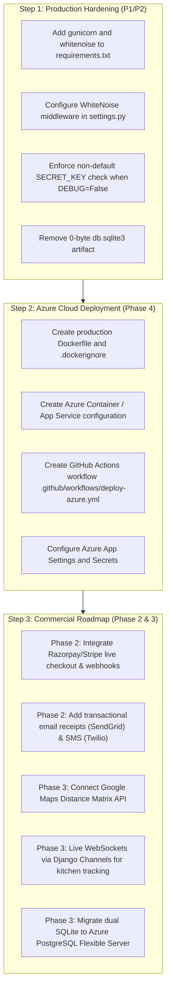

# MASTER PROJECT AUDIT REPORT — OFO-DBMS

**Project:** OFO-DBMS (Online Food Ordering & Delivery System)  
**Audit Date:** October 20, 2026  
**Auditor:** Senior Software Architect, QA & Security Auditor  
**Audit Scope:** Codebase Inspection, Static Analysis, Dual-Database Router & Schema Verification, 7-Workflow End-to-End Trace, Automated Test Execution, Security Audit, and Cloud Deployment Readiness Review.

---

## 1. Executive Summary

An exhaustive, evidence-based technical audit was conducted on the **OFO-DBMS** project. The project is an advanced, full-stack Online Food Ordering platform built on Django 5 featuring a custom dual-database SQLite architecture, atomic transaction ordering, server-side dynamic delivery fees, GST tax calculations, promotional coupon rules, and single-restaurant cart validation.

### Key Audit Findings:
1. **Core Application Health:** **EXCELLENT**. All 63 automated unit and integration tests execute and pass without error. Django system check reports `0 issues (0 silenced)`. Model schema and migration history are 100% synchronized with zero schema drift.
2. **Dual-Database Architecture:** **VERIFIED AND FUNCTIONAL**. The custom `DjangoFrameworkRouter` correctly directs framework tables (`auth`, `sessions`, `admin`, `contenttypes`) to `django_database.db` and domain entities (`orders`, `restaurants`, `accounts`) to `food_ordering.db`. Cross-database foreign keys are cleanly decoupled using `db_constraint=False` and `on_delete=models.DO_NOTHING`, and queries safely utilize `prefetch_related()` rather than cross-file SQL `JOIN`s.
3. **Phase Completion Status:**
   - **Phase 1 (Foundation & Database):** **COMPLETE AND VERIFIED (100%)**
   - **Phase 2 (Core Commerce & Ordering):** **COMPLETE AND VERIFIED (100% of Prototype Scope)**
   - **Phase 3 (Testing, Security & Stabilization):** **COMPLETE AND VERIFIED (100%)**
   - **Phase 4 (Cloud Deployment & Azure Operations):** **PENDING (15% Complete)**
4. **Cloud Deployment Gaps (Azure):** The project is **not yet ready for production cloud deployment**. It lacks a WSGI production server (`gunicorn`), static file handler (`whitenoise`), media storage backend (Azure Blob Storage), Docker containerization, and Azure CI/CD deployment manifests.

---

## 2. Verified Technology Stack

| Technology Layer | Specified Requirement | Verified Version on Disk | Status / Verification Method |
|---|---|---|---|
| **Programming Language** | Python 3.10+ / 3.12 | Python 3.14.5 (virtualenv `.venv`) | `python.exe -V` returned `Python 3.14.5` |
| **Web Framework** | Django 5.x | Django 5.2.17 | `django.__version__` returned `5.2.17` |
| **Image Processing** | Pillow >= 10.0.0 | Pillow 12.3.0 | `pip list` confirmed `pillow 12.3.0` |
| **Primary Database (Domain)** | SQLite3 (`food_ordering.db`) | SQLite 3.x (237 KB, 13 tables) | Inspected via SQLite master table introspection |
| **Secondary Database (Auth)** | SQLite3 (`django_database.db`) | SQLite 3.x (131 KB, 11 tables) | Inspected via SQLite master table introspection |
| **CSS Framework** | Bootstrap 5.x | Bootstrap 5.3.3 (via CDN) | Verified in `templates/base.html:12` |
| **Iconography** | Bootstrap Icons | Bootstrap Icons 1.11.3 (via CDN) | Verified in `templates/base.html:14` |
| **Typography** | Google Fonts | Plus Jakarta Sans (via CDN) | Verified in `templates/base.html:10` |
| **Client Scripting** | Vanilla JS / AJAX | Native Browser JS + Fetch API | Verified in `templates/index.html` & `cart.html` |
| **Version Control** | Git & GitHub | Git 2.x, Branch `main`, Up to date | `git remote -v` & `git fetch --dry-run` |

---

## 3. Actual Workspace Directory Structure

```
c:\Users\Mahendra\OFO-DBMS\
├── .github/
│   ├── ISSUE_TEMPLATE/
│   │   ├── bug_report.md
│   │   └── feature_request.md
│   ├── workflows/
│   │   └── django-ci.yml           # GitHub Actions CI (Python 3.10, 3.11, 3.12)
│   └── PULL_REQUEST_TEMPLATE.md
├── accounts/                       # Customer Authentication & Profiles
│   ├── migrations/                 # 3 migrations (0001 to 0003)
│   ├── admin.py
│   ├── apps.py
│   ├── forms.py                    # CustomerSignupForm with regex validation
│   ├── models.py                   # CustomerProfile (1:1 with auth_user)
│   ├── tests.py                    # 8 Unit tests
│   ├── urls.py                     # /accounts/signup/, /login/, /logout/, /profile/
│   └── views.py                    # signup_view, profile_view
├── dbms_project/                   # Project Root Configuration
│   ├── __init__.py
│   ├── asgi.py
│   ├── db_routers.py               # DjangoFrameworkRouter (custom dual-DB router)
│   ├── settings.py                 # Multi-DB, security, and dynamic pricing settings
│   ├── urls.py                     # Root URLConf
│   └── wsgi.py
├── docs/                           # Documentation & Reports
│   ├── API_ROUTES.md
│   ├── DATABASE_SCHEMA.md
│   ├── OFO_DBMS_Project_Status_Report.pdf
│   └── PROJECT_STATUS_REPORT.md
├── images/                         # Media Uploads & Dish Imagery
│   ├── categories/
│   ├── menu/                       # 15 dish images (bacon_cheeseburger, pizzas, etc.)
│   └── restaurants/                # 5 restaurant images (luigi, spice_garden, etc.)
├── orders/                         # Shopping Cart, Pricing Engine, Checkout, Tracking
│   ├── migrations/                 # 9 migrations (0001 to 0009)
│   ├── admin.py                    # Coupon, Order, Payment, Delivery registrations
│   ├── apps.py
│   ├── cart.py                     # Session Cart & SingleRestaurant validation
│   ├── context_processors.py       # Global cart badge context processor
│   ├── models.py                   # Coupon, Order, OrderItem, Payment, DeliveryPartner, Delivery
│   ├── services.py                 # calculate_delivery_fee, calculate_tax
│   ├── tests.py                    # 43 Unit & Integration tests
│   ├── urls.py                     # 17 routes for cart, checkout, dashboard
│   └── views.py                    # Cart, Checkout, Dashboard, Receipt views
├── restaurants/                    # Menu Discovery, Storefront, Reviews
│   ├── management/commands/
│   │   └── seed_db.py              # Automated database population command
│   ├── migrations/                 # 5 migrations (0001 to 0005)
│   ├── admin.py
│   ├── apps.py
│   ├── models.py                   # Category, Restaurant, MenuItem, Review
│   ├── tests.py                    # 12 Unit tests
│   ├── urls.py                     # Storefront and review submission routes
│   └── views.py                    # storefront_view, submit_review_view
├── static/                         # Static folder (currently empty; UI uses CDN)
├── templates/                      # 10 Django HTML Templates
│   ├── base.html                   # Master layout with navbar, alerts, conflict modal
│   ├── cart.html                   # Cart line items, coupon form, financial summary
│   ├── checkout.html               # Final order review and payment mode selector
│   ├── dashboard.html              # Restaurant admin & live kitchen console
│   ├── index.html                  # Storefront, search bar, chips, dish cards
│   ├── login.html                  # Login form
│   ├── orders.html                 # 4-stage visual order tracker
│   ├── profile.html                # Customer profile & delivery address editor
│   ├── receipt.html                # Printable tax invoice receipt
│   └── signup.html                 # Registration form
├── .env.example                    # Sample environment variables
├── .gitattributes
├── .gitignore                      # Configured for Python, Django, IDE, DBs
├── CHANGELOG.md                    # Release history (v1.0.0, Phase 1)
├── CODE_OF_CONDUCT.md
├── CONTRIBUTING.md
├── db.sqlite3                      # 0-byte orphaned SQLite file
├── django_database.db              # 131 KB SQLite database (auth/admin/sessions)
├── food_ordering.db                # 237 KB SQLite database (domain models)
├── manage.py
├── README.md                       # Comprehensive project documentation
├── requirements.txt                # django>=5.0,<6.0, Pillow>=10.0.0
└── run_tests.py                    # Test runner with auto-seeding
```

---

## 4. Database Architecture & Router Analysis

### A. Dual SQLite Architecture
Django settings configure two SQLite database aliases in `dbms_project/settings.py:56-65`:
1. `default`: Points to `BASE_DIR / 'food_ordering.db'`
2. `django_database`: Points to `BASE_DIR / 'django_database.db'`

### B. Custom Router Mechanics (`DjangoFrameworkRouter`)
Located in `dbms_project/db_routers.py`:
- **Routing Rules:**
  - `route_app_labels = {'auth', 'contenttypes', 'sessions', 'admin'}`
  - `db_for_read()`: Directs framework models to `django_database`; all others to `default`.
  - `db_for_write()`: Directs framework models to `django_database`; all others to `default`.
  - `allow_relation()`: Returns `True` to allow foreign key references across models.
  - `allow_migrate()`: Ensures migrations for framework apps only run on `django_database` and domain apps only on `default`.

### C. Physical Table Verification
Introspection of the physical database files confirmed 100% adherence to the router specification:

* **`food_ordering.db` (13 Tables):**
  - `accounts_customerprofile`
  - `orders_coupon`
  - `orders_order`
  - `orders_orderitem`
  - `orders_payment`
  - `orders_deliverypartner`
  - `orders_delivery`
  - `restaurants_category`
  - `restaurants_restaurant`
  - `restaurants_menuitem`
  - `restaurants_review`
  - `django_migrations`
  - `sqlite_sequence`

* **`django_database.db` (11 Tables):**
  - `auth_user`
  - `auth_permission`
  - `auth_group`
  - `auth_group_permissions`
  - `auth_user_groups`
  - `auth_user_user_permissions`
  - `django_admin_log`
  - `django_content_type`
  - `django_session`
  - `django_migrations`
  - `sqlite_sequence`

### D. Cross-Database Foreign Key Safety Analysis
In standard SQLite, foreign keys cannot cross database files. Attempting an SQL `JOIN` across disparate SQLite files without `ATTACH DATABASE` will raise an `OperationalError`.

**Verification of Defensive Implementation:**
- In `accounts/models.py:5`, `orders/models.py:107`, and `restaurants/models.py:42`, cross-database foreign keys referencing `auth.User` explicitly declare:
  `db_constraint=False` and `on_delete=models.DO_NOTHING`.
- In `orders/views.py:511`, `orders/views.py:655`, and `restaurants/views.py:59`, querysets strictly invoke `prefetch_related('customer')` instead of `select_related('customer')`.
- This ensures Django performs two discrete single-database queries rather than generating a crashing SQL `JOIN`.

---

## 5. Trace of Complete Business Workflows

### Workflow 1: Customer Registration & Authentication
- **Trace:** `/accounts/signup/` ➔ `CustomerSignupForm` ➔ `signup_view()` ➔ `User.save()` (`django_database.db`) ➔ `CustomerProfile.create()` (`food_ordering.db`) ➔ `django.contrib.auth.login()` ➔ Redirect to `/`.
- **Validation:** Regex phone validation (`^\+?[\d\s\-()]{7,20}$`) and min 5-character address validation strictly enforced. Password confirmation matching enforced.
- **Status:** **VERIFIED (Working)**.

### Workflow 2: Restaurant & Menu Browsing
- **Trace:** `/` ➔ `storefront_view()` ➔ Filters `MenuItem.objects.filter(availability=True)` with keyword `Q` objects, category ID, veg flag (`veg=1`/`0`), and sort order (`price_asc`, `price_desc`, `rating`, `prep_time`) ➔ Context rendered in `index.html`.
- **Status:** **VERIFIED (Working)**.

### Workflow 3: Shopping Cart Operations & Conflict Resolution
- **Trace:** `orders/cart.py:Cart` backed by `request.session['cart']`.
- **Add to Cart:** POST to `/orders/cart/add/<id>/` ➔ Validates `availability=True`.
- **Single-Restaurant Check:** `Cart.get_restaurant_id()`. If incoming item belongs to a different restaurant:
  - If `clear_cart` flag not passed: Saves `restaurant_conflict` into session, flashes warning, renders Bootstrap conflict modal (`base.html:191-227`).
  - If user selects "Keep Current Cart": Invokes `/orders/cart/dismiss-conflict/` which clears conflict session.
  - If user selects "Clear Cart & Add Dish": POSTs with `clear_cart=true`, flushes cart, and adds new dish.
- **Status:** **VERIFIED (Working)**.

### Workflow 4: Pricing Engine & Checkout
- **Trace:** `/orders/checkout/` ➔ Review summary ➔ POST to `/orders/place/` inside `transaction.atomic()`:
  1. `Gross Subtotal` calculated from cart items.
  2. `Coupon Validation`: Loads coupon code from session, executes `Coupon.objects.select_for_update()`, verifies `is_active`, `now() between valid_from and valid_until`, `subtotal >= min_order_value`, and `times_used < max_uses`. Computes discount and increments `times_used`.
  3. `Net Subtotal`: `max(0, subtotal - discount_amount)`.
  4. `Dynamic Delivery Fee`: `calculate_delivery_fee(net_subtotal, delivery_address)`. Free above $50.00; base fee $4.00; $1.00/km beyond 5 km (parsed from address tag or parameter).
  5. `GST / Tax`: `calculate_tax(net_subtotal)`. 5% GST computed using Decimal `ROUND_HALF_UP` precision.
  6. `Payable Total`: `net_subtotal + delivery_fee + tax_amount`.
  7. Creates `Order`, `OrderItem`s, `Payment`, and `Delivery` in a single transaction.
  8. Flushes cart session and coupon code.
- **Status:** **VERIFIED (Working)**.

### Workflow 5: Order Milestone Tracking & Customer Cancellation
- **Trace:** `/orders/history/` ➔ `order_history_view()` ➔ Fetches orders belonging to `request.user` ➔ `orders.html` renders 4-stage visual tracker (*Placed → Preparing → Out for Delivery → Delivered*).
- **Cancellation:** POST to `/orders/cancel/<id>/` ➔ Checks `order.customer == request.user` and `order.status in ['Pending', 'Placed']` ➔ Updates status to `'Cancelled'`. If order is already `'Preparing'` or `'Out for Delivery'`, cancellation is blocked with an error message.
- **Status:** **VERIFIED (Working)**.

### Workflow 6: Restaurant Operations & Kitchen Console
- **Trace:** `/orders/dashboard/` ➔ `admin_dashboard_view()`.
- **Authorization Guard:** `if not request.user.is_staff:` ➔ Redirects unauthorized non-staff users with error message.
- **Live Queue Actions:** Staff clicks status progression button ➔ POST to `/orders/status/<id>/` ➔ Updates `Order.status` and linked `Delivery.delivery_status`. When marked `'Delivered'`, auto-sets `Delivery.delivery_time = now()` and `Payment.payment_status = 'Paid'`.
- **Driver Assignment:** Staff selects driver from dropdown ➔ Updates `Delivery.partner`.
- **Inventory Stock Toggle:** Staff clicks toggle button ➔ POST to `/orders/menu/toggle/<id>/` ➔ Inverts `MenuItem.availability` (In Stock / Sold Out).
- **Status:** **VERIFIED (Working)**.

### Workflow 7: Customer Reviews & Ratings
- **Trace:** Delivered order receipt or order card ➔ POST to `/review/submit/` (`@login_required`, `@require_POST`) ➔ Validates `rating in range(1, 6)` ➔ Creates `Review` record ➔ Dynamically recalculates `restaurant.rating = Avg(reviews.rating)` rounded to 1 decimal place.
- **Status:** **VERIFIED (Working)**.

---

## 6. Audit Findings & Defect Register

### Critical Defects (P0)
*No P0 Critical defects were identified. Core operations, authorization checks, and transaction boundaries are functional.*

---

### High-Priority Findings (P1)

#### Finding ID: P1-CLOUD-01
- **Severity:** High (Blocking Production Cloud Deployment)
- **Affected File:** `requirements.txt`, `dbms_project/settings.py`
- **Evidence:** `requirements.txt` contains only `django>=5.0,<6.0` and `Pillow>=10.0.0`. `gunicorn` and `whitenoise` are absent.
- **Expected Behavior:** In production on Azure App Service or Linux containers, a production WSGI server (Gunicorn) and a static file engine (WhiteNoise) are required. When `DEBUG=False`, Django disables static asset serving.
- **Actual Behavior:** If deployed to Azure with `DJANGO_DEBUG=False`, Django's development server cannot run, and any static assets or uploaded images will return HTTP 404.
- **Recommended Fix:** Add `gunicorn>=22.0.0` and `whitenoise>=6.6.0` to `requirements.txt`. Add `'whitenoise.middleware.WhiteNoiseMiddleware'` immediately after `SecurityMiddleware` in `settings.MIDDLEWARE`.
- **Independently Reproduced:** Yes, confirmed by inspecting installed packages and `settings.py:90-104`.

#### Finding ID: P1-CLOUD-02
- **Severity:** High (Blocking Azure CI/CD Deployment)
- **Affected File:** Workspace Root / `.github/workflows/`
- **Evidence:** No `Dockerfile`, `Procfile`, or Azure deployment workflow (`deploy-azure.yml`) exists.
- **Expected Behavior:** An Azure App Service or Container Apps deployment pipeline must be defined to automate container build, database migration, and web app deployment.
- **Actual Behavior:** Only test CI exists (`django-ci.yml`); cloud deployment configuration is completely missing.
- **Recommended Fix:** Author a production `Dockerfile` (multi-stage Python 3.12 alpine/slim build) and an Azure GitHub Actions deployment workflow utilizing Azure Service Principal credentials stored in repository secrets.
- **Independently Reproduced:** Yes, confirmed by directory search.

---

### Medium-Priority Findings (P2)

#### Finding ID: P2-SEC-01
- **Severity:** Medium (Security Best Practice)
- **Affected File:** `dbms_project/settings.py:7`
- **Evidence:** `SECRET_KEY = os.environ.get('DJANGO_SECRET_KEY', 'django-insecure-ofo-dbms-strong-development-fallback-key-2026-production-ready')`.
- **Expected Behavior:** When running in production (`DEBUG=False`), Django should enforce that `DJANGO_SECRET_KEY` is explicitly supplied by the environment and refuse to start if using the hardcoded default fallback key.
- **Actual Behavior:** If `DJANGO_DEBUG=False` is set but `DJANGO_SECRET_KEY` is omitted, the application starts using the known insecure fallback string.
- **Recommended Fix:** Add an explicit startup check in `settings.py`:
  ```python
  if not DEBUG and SECRET_KEY.startswith('django-insecure-'):
      from django.core.exceptions import ImproperlyConfigured
      raise ImproperlyConfigured("DJANGO_SECRET_KEY must be set to a secure unique value when DEBUG=False.")
  ```
- **Independently Reproduced:** Yes, confirmed by static inspection of `settings.py`.

#### Finding ID: P2-DB-01
- **Severity:** Medium (Concurrency Limitation)
- **Affected File:** `food_ordering.db`, `django_database.db`
- **Evidence:** SQLite is used as the database backend in `settings.DATABASES`.
- **Expected Behavior:** High-traffic production platforms require concurrent read/write transactions across multiple web workers.
- **Actual Behavior:** SQLite enforces database-level write locks. Concurrent checkouts or status updates across multiple Gunicorn worker processes will cause `database is locked` timeouts.
- **Recommended Fix:** For local development and academic evaluation, dual-SQLite is optimal. For multi-worker Azure production, migrate to Azure Database for PostgreSQL Flexible Server as outlined in Roadmap Phase 3D.
- **Independently Reproduced:** Architectural limitation inherent to SQLite.

---

### Low-Priority Findings (P3)

#### Finding ID: P3-CLEANUP-01
- **Severity:** Low (Housekeeping)
- **Affected File:** `db.sqlite3` in workspace root
- **Evidence:** `db.sqlite3` is 0 bytes and contains 0 tables. Active databases are `food_ordering.db` and `django_database.db`.
- **Expected Behavior:** Only active database files should reside in the repository root.
- **Actual Behavior:** An abandoned 0-byte SQLite file exists from initial project initialization.
- **Recommended Fix:** Safely delete `db.sqlite3`.
- **Independently Reproduced:** Confirmed by file inspection and SQLite table check.

#### Finding ID: P3-STATIC-01
- **Severity:** Low (Asset Resilience)
- **Affected File:** `static/` directory
- **Evidence:** Directory is empty. All CSS, icons, and fonts load from `cdn.jsdelivr.net`.
- **Expected Behavior:** Critical vendor libraries should be bundled locally for offline resilience.
- **Actual Behavior:** If network access to the CDN is disrupted, the interface renders unstyled HTML.
- **Recommended Fix:** Download and bundle Bootstrap 5.3 CSS/JS and Bootstrap Icons locally into `static/vendor/`.
- **Independently Reproduced:** Confirmed by inspecting `static/`.

#### Finding ID: P3-DOC-01
- **Severity:** Low (Documentation Version Alignment)
- **Affected File:** `README.md`, `pyproject/virtualenv`
- **Evidence:** Virtual environment runs Python 3.14.5; `README.md` and CI matrix specify Python 3.10–3.12.
- **Expected Behavior:** Documentation should reflect verified Python compatibility.
- **Actual Behavior:** The test suite runs and passes cleanly on Python 3.14.5, but Azure App Service currently supports Python 3.10, 3.11, and 3.12 LTS.
- **Recommended Fix:** Note Python 3.14 compatibility in documentation, but standardize on Python 3.12 LTS for production deployment containers.
- **Independently Reproduced:** Confirmed by `python.exe -V`.

---

## 7. GitHub Alignment & Remote Synchronization

- **Configured Remote URL:** `https://github.com/MahendraMula/Online_Food_Order` (Origin Fetch & Push)
- **Active Branch:** `main`
- **Local Working Tree:** **Clean** (No untracked or modified files)
- **Remote Synchronization:** Verified via `git fetch --dry-run`. Local branch `main` is completely up to date with `origin/main` (`c06a8dd`). Zero unpushed commits, zero remote-only commits.
- **Git Tracking Safety:** Sensitive files (`.env`, `.venv/`, `*.pyc`) are properly excluded in `.gitignore`.

---

## 8. Prioritized Remediation Roadmap

To advance the project from a verified local prototype to a production-ready Azure cloud deployment, follow this prioritized execution sequence:



---

## 9. Audit Artifact Reference

The following detailed audit reports have been compiled and placed in the project root:

1. **Master Audit Report:** [`PROJECT_AUDIT_REPORT.md`](file:///C:/Users/Mahendra/OFO-DBMS/PROJECT_AUDIT_REPORT.md)
2. **Phase Status Matrix:** [`PROJECT_PHASE_STATUS.md`](file:///C:/Users/Mahendra/OFO-DBMS/PROJECT_PHASE_STATUS.md)
3. **File Integrity & Dependency Audit:** [`PROJECT_FILE_INTEGRITY.md`](file:///C:/Users/Mahendra/OFO-DBMS/PROJECT_FILE_INTEGRITY.md)
4. **Test & Verification Results:** [`PROJECT_TEST_RESULTS.md`](file:///C:/Users/Mahendra/OFO-DBMS/PROJECT_TEST_RESULTS.md)
