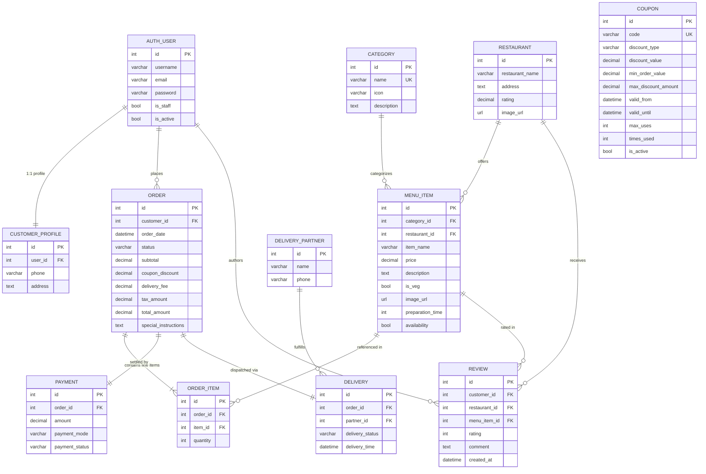

# OFO-DBMS — Online Food Ordering & Delivery Management System

[](https://www.python.org/)
[](https://www.djangoproject.com/)
[](https://www.sqlite.org/)
[](https://azure.microsoft.com/)
[-black?logo=githubactions&logoColor=white)](https://github.com/features/actions)
[](#)
[](#11-test-suite--quality-assurance)
[-success)](#2-public-access--live-deployment)

A production-engineered, full-stack online food ordering and delivery management system built with **Python 3**, **Django 5**, and a **dual-database SQLite architecture**. Deployed natively to **Microsoft Azure App Service (Linux)** with automated **GitHub Actions CI/CD**, production **Gunicorn** WSGI application server, and **WhiteNoise** static asset distribution.

---

## Table of Contents
1. [Project Overview](#1-project-overview)
2. [Public Access & Live Deployment](#2-public-access--live-deployment)
3. [System Architecture](#3-system-architecture)
4. [Database Management System (DBMS) Architecture](#4-database-management-system-dbms-architecture)
   - [Dual-Database Strategy](#dual-database-strategy)
   - [Entity-Relationship Diagram (ERD)](#entity-relationship-diagram-erd)
   - [Schema & Table Specifications](#schema--table-specifications)
   - [Transaction Management & Integrity Controls](#transaction-management--integrity-controls)
   - [Custom Router Implementation](#custom-router-implementation)
5. [Azure App Service Deployment Engineering](#5-azure-app-service-deployment-engineering)
   - [Cloud Infrastructure Overview](#cloud-infrastructure-overview)
   - [How the Website Was Made Public](#how-the-website-was-made-public)
   - [Persistent Cloud Storage (/home/data)](#persistent-cloud-storage-homedata)
   - [Gunicorn WSGI Server Configuration](#gunicorn-wsgi-server-configuration)
   - [Custom Container Startup Script (startup.sh)](#custom-container-startup-script-startupsh)
   - [Automated CI/CD Pipeline (GitHub Actions & OIDC)](#automated-cicd-pipeline-github-actions--oidc)
   - [Azure Environment Variables Reference](#azure-environment-variables-reference)
6. [Core Business Features & Workflows](#6-core-business-features--workflows)
   - [Customer Storefront & Ordering](#customer-storefront--ordering)
   - [Commercial Essentials Engine](#commercial-essentials-engine)
   - [Restaurant Operations & Kitchen Console](#restaurant-operations--kitchen-console)
7. [Pricing & Tax Formula](#7-pricing--tax-formula)
8. [Project Structure](#8-project-structure)
9. [Local Installation & Setup](#9-local-installation--setup)
10. [Important Application Endpoints](#10-important-application-endpoints)
11. [Test Suite & Quality Assurance](#11-test-suite--quality-assurance)
12. [Future Enhancements](#12-future-enhancements)

---

## 1. Project Overview

**OFO-DBMS** simulates a commercial multi-restaurant food delivery platform (similar to Zomato or Swiggy). The system orchestrates the complete lifecycle of food ordering, kitchen processing, dispatching, and fiscal accounting:

* **Customer Workflow**: Account creation with phone/address profiling, dynamic multi-restaurant browsing, real-time keyword search, vegetarian filtering, single-restaurant cart isolation, promotional coupon validation, distance-based dynamic delivery fee calculations, GST calculation, atomic multi-table checkout, live 4-stage order milestone tracking, and dish/restaurant reviews.
* **Restaurant Operations Workflow**: A dedicated staff dashboard (`/orders/dashboard/`) providing executive business KPI tracking (gross revenue, active kitchen queue, completed deliveries, menu inventory metrics), real-time dish stock availability toggling (*In Stock / Sold Out*), delivery driver registration, driver assignment, and one-click order status transitions (*Preparing → Out for Delivery → Delivered*).

---

## 2. Public Access & Live Deployment

The system is configured, containerized, and deployed as a publicly accessible web application on **Microsoft Azure App Service**:

| Deployment Attribute | Production Configuration |
|---|---|
| **Public URL** | `https://ofo-dbms-a9.azurewebsites.net` *(or custom Azure Web App hostname)* |
| **Hosting Platform** | Microsoft Azure App Service (Linux Web App) |
| **Runtime Stack** | Python 3.12 (B1 / S1 App Service Tier) |
| **Web Server / WSGI** | Gunicorn 23.x with threaded workers (`gthread`) on port 8000 |
| **Static Assets** | WhiteNoise 6.8+ (Gzip & Brotli pre-compressed, hash-manifested) |
| **SSL / TLS Certificate** | Managed Azure SSL Certificate (Zero-cost automatic HTTPS) |
| **Authentication Strategy** | OpenID Connect (OIDC) Federated Credentials (Passwordless CI/CD) |

### Demo Accounts for Public Evaluation
Visitors evaluating the public deployment can utilize the following pre-seeded customer accounts:

| Role | Username | Password | Default Address |
|---|---|---|---|
| **Customer 1** | `customer_alice` | `Demo@1234` | 104 Park Avenue, Suite 3B [dist: 4.2km] |
| **Customer 2** | `customer_bob` | `Demo@1234` | 742 Evergreen Terrace [dist: 7.8km] |
| **Customer 3** | `customer_carol` | `Demo@1234` | 221B Baker Street [dist: 2.5km] |
| **Administrator** | Created via `createsuperuser` | Admin defined | Operations & Django Admin Console access |

---

## 3. System Architecture

```
┌────────────────────────────────────────────────────────────────────────┐
│                        Worldwide Web Users                             │
│       Mobile Browsers  │  Desktop Clients  │  API Consumers            │
└───────────────────────────────────┬────────────────────────────────────┘
                                    │ HTTPS (TLS 1.3)
                                    ▼
┌────────────────────────────────────────────────────────────────────────┐
│                  Azure Front Door / Reverse Proxy                      │
│   - SSL Termination & Offloading                                       │
│   - Inject X-Forwarded-Proto: https & X-Forwarded-For                  │
└───────────────────────────────────┬────────────────────────────────────┘
                                    │ Reverse Proxy Routing
                                    ▼
┌────────────────────────────────────────────────────────────────────────┐
│                 Azure App Service Container (Linux)                    │
│                                                                        │
│   ┌────────────────────────────────────────────────────────────────┐   │
│   │               Gunicorn WSGI Master Server (Port 8000)          │   │
│   │               2 Workers  │  4 Threads per Worker (gthread)     │   │
│   └───────────────────────────────┬────────────────────────────────┘   │
│                                   │                                    │
│   ┌───────────────────────────────▼────────────────────────────────┐   │
│   │                       Django 5 Application                     │   │
│   │                                                                │   │
│   │   [Security Middleware]       [WhiteNoise Static Middleware]   │   │
│   │   • Proxy SSL Header Check    • Serves hashed /static/ files   │   │
│   │   • Dynamic CSRF Origin Guard • Browser cache headers          │   │
│   │                                                                │   │
│   │   [App Modules]                                                │   │
│   │   • accounts     (Auth, CustomerProfile, Address Book)         │   │
│   │   • restaurants  (Catalog, Categories, Dishes, Reviews)        │   │
│   │   • orders       (Cart, Coupon Engine, Tax & Delivery Engine)  │   │
│   └───────────────────────────────┬────────────────────────────────┘   │
│                                   │                                    │
│   ┌───────────────────────────────▼────────────────────────────────┐   │
│   │           DjangoFrameworkRouter (db_routers.py)                │   │
│   └───────────────┬───────────────────────────────┬────────────────┘   │
│                   │                               │                    │
│                   ▼                               ▼                    │
│   ┌──────────────────────────────┐ ┌──────────────────────────────┐    │
│   │      Domain Database         │ │    Framework Database        │    │
│   │   /home/data/food_ordering.db│ │/home/data/django_database.db │    │
│   │                              │ │                              │    │
│   │  • accounts_customerprofile  │ │  • auth_user / auth_group    │    │
│   │  • restaurants_category      │ │  • django_session            │    │
│   │  • restaurants_restaurant    │ │  • django_content_type       │    │
│   │  • restaurants_menuitem      │ │  • django_admin_log          │    │
│   │  • restaurants_review        │ └──────────────────────────────┘    │
│   │  • orders_order              │                                     │
│   │  • orders_orderitem          │                                     │
│   │  • orders_coupon             │                                     │
│   │  • orders_payment            │                                     │
│   │  • orders_deliverypartner    │                                     │
│   │  • orders_delivery           │                                     │
│   └──────────────────────────────┘                                     │
│                                                                        │
│   Persistent Storage Volume (/home/data) — Survives Deployments/Restarts│
└────────────────────────────────────────────────────────────────────────┘
```

---

## 4. Database Management System (DBMS) Architecture

The database architecture is designed according to **Third Normal Form (3NF)** principles to ensure high data integrity, modular separation of concerns, and robust concurrent transaction processing.

### Dual-Database Strategy

Rather than storing all records inside a monolithic database file, OFO-DBMS implements a **Dual-Database Architecture**:

| Database Identity | Alias | Storage File | Responsibilities & Stored Entities |
|---|---|---|---|
| **Domain Database** | `default` | `food_ordering.db` | Contains all business entities: Customer profiles, Restaurant listings, Categories, Menu items, Customer reviews, Orders, Line items, Promotional coupons, Payment records, and Driver deliveries. |
| **Framework Database** | `django_database` | `django_database.db` | Contains internal framework operations: User authentication credentials (`auth_user`), session cookies (`django_session`), permission mappings, content types, and administrative action audit trails. |

#### Architectural Advantages of Dual DBMS:
1. **Decoupled Concerns**: High-frequency web sessions and Django framework administrative audit logs never lock or fragment the core financial and order placement tables.
2. **Independent Backup & Migration Cycles**: The core domain database can be archived, restored, or migrated to enterprise RDBMS backends (e.g., Azure Database for PostgreSQL) without altering authentication tables.
3. **Database Constraint Isolation**: Cross-database foreign keys between `CustomerProfile` / `Order` and `auth_user` utilize `db_constraint=False`, allowing independent transaction scopes while preserving ORM object traversals.

---

### Entity-Relationship Diagram (ERD)



---

### Schema & Table Specifications

#### 1. `accounts_customerprofile` (Stored in `food_ordering.db`)
Extends Django's user table with phone validation and geographic delivery destinations.
* `id` (INTEGER, Primary Key, Auto-increment)
* `user_id` (INTEGER, Foreign Key → `auth_user`, `db_constraint=False`)
* `phone` (VARCHAR(15), Regex verified `^\+?[0-9]{10,15}$`)
* `address` (TEXT, Mandatory physical delivery address)

#### 2. `restaurants_category` (Stored in `food_ordering.db`)
Classification taxonomy for storefront menu items.
* `id` (INTEGER, Primary Key, Auto-increment)
* `name` (VARCHAR(100), UNIQUE, e.g., "Biryani & Rice", "Pizzas & Pasta", "Desserts")
* `icon` (VARCHAR(50), Bootstrap Icons identifier)
* `description` (TEXT, Category editorial description)

#### 3. `restaurants_restaurant` (Stored in `food_ordering.db`)
Master registry of partner culinary kitchens.
* `id` (INTEGER, Primary Key, Auto-increment)
* `restaurant_name` (VARCHAR(255), Legal business name)
* `address` (TEXT, Kitchen kitchen location)
* `rating` (DECIMAL(3, 1), Auto-recalculated customer rating average)
* `image_url` (URLField / Relative path to restaurant banner photo)

#### 4. `restaurants_menuitem` (Stored in `food_ordering.db`)
Individual dishes and beverages.
* `id` (INTEGER, Primary Key, Auto-increment)
* `category_id` (INTEGER, Foreign Key → `restaurants_category`, SET_NULL)
* `restaurant_id` (INTEGER, Foreign Key → `restaurants_restaurant`, CASCADE)
* `item_name` (VARCHAR(255), Dish name)
* `price` (DECIMAL(6, 2), Server-authoritative price)
* `description` (TEXT, Ingredients and culinary summary)
* `is_veg` (BOOLEAN, Pure vegetarian dietary flag)
* `image_url` (URLField / Relative path to dish photo)
* `preparation_time` (INTEGER, Average kitchen turnaround in minutes)
* `availability` (BOOLEAN, Dynamic inventory stock toggle)

#### 5. `restaurants_review` (Stored in `food_ordering.db`)
Verified feedback loop for dishes and restaurants.
* `id` (INTEGER, Primary Key, Auto-increment)
* `customer_id` (INTEGER, Foreign Key → `auth_user`, `db_constraint=False`)
* `restaurant_id` (INTEGER, Foreign Key → `restaurants_restaurant`, CASCADE)
* `menu_item_id` (INTEGER, Foreign Key → `restaurants_menuitem`, SET_NULL, Optional)
* `rating` (INTEGER, Range: 1 to 5 stars)
* `comment` (TEXT, Customer feedback narrative)
* `created_at` (DATETIME, Auto-timestamp)

#### 6. `orders_order` (Stored in `food_ordering.db`)
Central transaction header recording order metadata and itemized financials.
* `id` (INTEGER, Primary Key, Auto-increment)
* `customer_id` (INTEGER, Foreign Key → `auth_user`, `db_constraint=False`)
* `order_date` (DATETIME, Auto-timestamp)
* `status` (VARCHAR(50), Choices: `Pending`, `Placed`, `Preparing`, `Out for Delivery`, `Delivered`, `Cancelled`)
* `subtotal` (DECIMAL(8, 2), Gross food item sum)
* `coupon_discount` (DECIMAL(8, 2), Deducted promo discount)
* `delivery_fee` (DECIMAL(8, 2), Distance-evaluated logistics fee)
* `tax_amount` (DECIMAL(8, 2), Computed 5% GST tax)
* `total_amount` (DECIMAL(8, 2), Net payable sum)
* `special_instructions` (TEXT, Customer dietary or drop-off requests)

#### 7. `orders_orderitem` (Stored in `food_ordering.db`)
Discrete line items within an order.
* `id` (INTEGER, Primary Key, Auto-increment)
* `order_id` (INTEGER, Foreign Key → `orders_order`, CASCADE)
* `item_id` (INTEGER, Foreign Key → `restaurants_menuitem`, `on_delete=models.PROTECT`)
  *(Ensures historical order receipts cannot be corrupted if a dish is retired).*
* `quantity` (INTEGER, Order multiplier $\ge 1$)

#### 8. `orders_coupon` (Stored in `food_ordering.db`)
Promotional discount rules engine.
* `id` (INTEGER, Primary Key, Auto-increment)
* `code` (VARCHAR(50), UNIQUE uppercase promo string, e.g., `WELCOME50`, `FLAT100`)
* `discount_type` (VARCHAR(20), Choices: `PERCENTAGE`, `FLAT`)
* `discount_value` (DECIMAL(6, 2), Numeric discount percentage or currency deduction)
* `min_order_value` (DECIMAL(8, 2), Eligibility cart threshold)
* `max_discount_amount` (DECIMAL(8, 2), Maximum ceiling cap for percentage discounts)
* `valid_from` & `valid_until` (DATETIME, Temporal validity range)
* `max_uses` (INTEGER, Global maximum redemption ceiling)
* `times_used` (INTEGER, Current redemption counter)
* `is_active` (BOOLEAN, Manual operational kill-switch)

#### 9. `orders_payment` (Stored in `food_ordering.db`)
1-to-1 financial settlement record for each order.
* `id` (INTEGER, Primary Key, Auto-increment)
* `order_id` (INTEGER, OneToOneField → `orders_order`, CASCADE)
* `amount` (DECIMAL(8, 2), Settled transaction total)
* `payment_mode` (VARCHAR(50), Choices: `COD`, `Card`, `UPI`)
* `payment_status` (VARCHAR(50), Choices: `Pending`, `Paid`, `Failed`)

#### 10. `orders_deliverypartner` (Stored in `food_ordering.db`)
Fleet roster of active delivery drivers.
* `id` (INTEGER, Primary Key, Auto-increment)
* `name` (VARCHAR(255), Driver full name)
* `phone` (VARCHAR(15), Contact number)

#### 11. `orders_delivery` (Stored in `food_ordering.db`)
Fulfillment tracking and driver assignment status.
* `id` (INTEGER, Primary Key, Auto-increment)
* `order_id` (INTEGER, OneToOneField → `orders_order`, CASCADE)
* `partner_id` (INTEGER, Foreign Key → `orders_deliverypartner`, SET_NULL)
* `delivery_status` (VARCHAR(50), Choices: `Assigned`, `In Progress`, `Picked Up`, `Delivered`)
* `delivery_time` (DATETIME, Completion timestamp)

---

### Transaction Management & Integrity Controls

1. **ACID Transaction Scope (`transaction.atomic`)**:
   During checkout, creating the `Order`, iterating over cart items to instantiate `OrderItem` rows, creating the `Payment` ledger, assigning initial `Delivery` dispatch, and clearing session storage is executed strictly within `with transaction.atomic():`. If any insert fails, all operations rollback cleanly.

2. **Concurrency Control & Row Locking (`select_for_update`)**:
   When validating promotional coupons with global usage quotas (`max_uses`), the coupon row is locked during validation:
   ```python
   coupon = Coupon.objects.select_for_update().get(code__iexact=coupon_code)
   ```
   This prevents race conditions where simultaneous checkouts could over-redeem limited promo codes.

3. **Server-Side Financial Recomputation**:
   Client-submitted totals or altered payload pricing values are discarded. All calculations (gross subtotal, coupon deduction, dynamic delivery fee, 5% GST, and grand total) are calculated authoritatively on the backend using Python's `Decimal` with `ROUND_HALF_UP` precision.

4. **Referential Integrity Defense**:
   All `OrderItem` instances bind to `MenuItem` using `on_delete=models.PROTECT`. If an administrator attempts to delete a dish that has historical customer orders, the DBMS halts the deletion. Dishes can be taken off the storefront non-destructively using the `availability = False` stock toggle.

---

### Custom Router Implementation

Located in `dbms_project/db_routers.py`, the `DjangoFrameworkRouter` inspects model metadata and routes every database read, write, and migration dynamically:

```python
class DjangoFrameworkRouter:
    """
    Directs Django internal apps (auth, sessions, contenttypes, admin)
    to 'django_database' and business domain apps to 'default'.
    """
    FRAMEWORK_APPS = {
        'admin',
        'auth',
        'contenttypes',
        'sessions',
        'messages',
    }

    def db_for_read(self, model, **hints):
        if model._meta.app_label in self.FRAMEWORK_APPS:
            return 'django_database'
        return 'default'

    def db_for_write(self, model, **hints):
        if model._meta.app_label in self.FRAMEWORK_APPS:
            return 'django_database'
        return 'default'

    def allow_relation(self, obj1, obj2, **hints):
        return True

    def allow_migrate(self, db, app_label, model_name=None, **hints):
        if app_label in self.FRAMEWORK_APPS:
            return db == 'django_database'
        return db == 'default'
```

---

## 5. Azure App Service Deployment Engineering

### Cloud Infrastructure Overview

OFO-DBMS is hosted on **Microsoft Azure App Service** using a native **Linux Container Plan** (Python 3.12 runtime). Deploying a dual-database Django application with zero-downtime and multi-tenant public access required specific architectural and cloud engineering solutions:

```
[GitHub Repository] ──(Push to main)──> [GitHub Actions CI/CD Pipeline]
                                                  │
                                                  ├─ 1. Run Automated Test Suite (Python 3.12)
                                                  ├─ 2. Collect & Compress Static Assets (WhiteNoise)
                                                  ├─ 3. Package Clean Deployment Bundle (release.zip)
                                                  ├─ 4. Authenticate to Azure via OIDC (Passwordless)
                                                  └─ 5. Deploy to Azure Web App (azure/webapps-deploy)
                                                                  │
                                                                  ▼
                                              [Azure App Service: ofo-dbms-a9]
                                                                  │
                                                Executes: bash startup.sh
                                                  ├─ Ensures /home/data volume exists
                                                  ├─ Migrates food_ordering.db
                                                  ├─ Migrates django_database.db
                                                  ├─ Auto-seeds catalog & demo users
                                                  └─ Spawns Gunicorn WSGI Server (port 8000)
```

---

### How the Website Was Made Public

Making a secure Django application public to the internet behind Azure's reverse proxies requires resolving critical production networking considerations:

#### 1. Reverse Proxy SSL Termination & Preventing Infinite 301 Loops
Azure App Service terminates incoming HTTPS connections at the front-end Azure load balancer, then forwards unencrypted HTTP traffic to the Gunicorn container over internal virtual networks with header `X-Forwarded-Proto: https`.
* **The Problem**: Standard Django `SECURE_SSL_REDIRECT = True` checks the internal protocol (`http`) and sends a `301 Moved Permanently` redirect to `https://...`, resulting in an infinite redirect loop.
* **The Solution**: In `dbms_project/settings.py`, we configured:
  ```python
  SECURE_PROXY_SSL_HEADER = ('HTTP_X_FORWARDED_PROTO', 'https')
  SECURE_SSL_REDIRECT = os.environ.get('DJANGO_SECURE_SSL_REDIRECT', 'True').lower() in ('true', '1', 'yes')
  ```
  Django now recognizes that Azure's reverse proxy already secured the connection via TLS/SSL.

#### 2. Cross-Site Request Forgery (CSRF) for Public Origins
Browsers submitting login credentials, address updates, cart items, or payments from the public web transmit HTTPS origin headers (`https://ofo-dbms-a9.azurewebsites.net`).
* **The Problem**: Django's CSRF protection strictly blocks requests whose `Origin` header does not match `CSRF_TRUSTED_ORIGINS`, throwing `HTTP 403 Forbidden`.
* **The Solution**: In `dbms_project/settings.py`, dynamic trusted origin synthesis was implemented:
  ```python
  raw_csrf_origins = os.environ.get('DJANGO_CSRF_TRUSTED_ORIGINS', '')
  if raw_csrf_origins:
      CSRF_TRUSTED_ORIGINS = [o.strip() for o in raw_csrf_origins.split(',') if o.strip()]
  else:
      CSRF_TRUSTED_ORIGINS = [
          f"https://{h}" for h in ALLOWED_HOSTS if h not in ('*', '127.0.0.1', 'localhost', 'testserver')
      ]
  ```
  This automatically trusts all public Azure App Service domains and custom hostnames.

#### 3. Allowed Hosts Configuration
Public users query the application from various domains and IPs. In `dbms_project/settings.py`:
```python
ALLOWED_HOSTS = [h.strip() for h in os.environ.get('DJANGO_ALLOWED_HOSTS', '127.0.0.1,localhost,testserver,*').split(',') if h.strip()]
```
On Azure, `DJANGO_ALLOWED_HOSTS` is configured with `*.azurewebsites.net,ofo-dbms-a9.azurewebsites.net`.

#### 4. High-Performance Static Asset Delivery with WhiteNoise
In production, Django does not serve static files (CSS, JavaScript, SVG icons). Rather than provisioning an expensive external storage bucket (AWS S3 or Azure Blob) for static assets, **WhiteNoise** was embedded:
```python
STORAGES = {
    "default": {
        "BACKEND": "django.core.files.storage.FileSystemStorage",
    },
    "staticfiles": {
        "BACKEND": "whitenoise.storage.CompressedManifestStaticFilesStorage",
    },
}
```
During the CI/CD build step, `python manage.py collectstatic --noinput` pre-compresses and fingerprints all CSS and JavaScript assets, enabling Gunicorn to serve them directly with infinite HTTP cache headers.

#### 5. Production Secret Key Security Gate
To prevent deploying vulnerable applications with public default secret keys:
```python
if not DEBUG and (not SECRET_KEY or SECRET_KEY.startswith('django-insecure-')):
    from django.core.exceptions import ImproperlyConfigured
    raise ImproperlyConfigured("DJANGO_SECRET_KEY must be explicitly set to a secure, unique production value when DEBUG=False.")
```

---

### Persistent Cloud Storage (`/home/data`)

On Azure App Service Linux, the default container root filesystem (`/`) is **ephemeral**. Any files created at the root or within the application directory (`/home/site/wwwroot/`) are reset whenever the web app restarts, scales, or deploys a new release.

* **The Problem**: A standard SQLite database located in `BASE_DIR` would be erased and overwritten on every deployment, destroying customer orders and accounts!
* **The Solution**: Azure mounts a persistent network storage volume at `/home`. We parameterized the database storage directory via `OFO_DATA_DIR` in `dbms_project/settings.py`:
  ```python
  DATA_DIR = Path(os.environ.get('OFO_DATA_DIR', str(BASE_DIR)))
  DATA_DIR.mkdir(parents=True, exist_ok=True)

  DATABASES = {
      'default': {
          'ENGINE': 'django.db.backends.sqlite3',
          'NAME': DATA_DIR / 'food_ordering.db',
      },
      'django_database': {
          'ENGINE': 'django.db.backends.sqlite3',
          'NAME': DATA_DIR / 'django_database.db',
      }
  }
  ```
* On Azure App Service, `OFO_DATA_DIR` is set to `/home/data`. When new code packages deploy, the SQLite databases in `/home/data/` persist undisturbed.
* **Operational Constraint**: Because SQLite uses file-system locking mechanisms (`fcntl`), the Azure App Service plan is pinned to **Scale Out = 1 Instance** with **Always On = True** to prevent multi-container write contention.

---

### Gunicorn WSGI Server Configuration

The production WSGI server is managed by `gunicorn.conf.py`:

```python
import os

bind = os.environ.get("GUNICORN_BIND", "0.0.0.0:8000")
backlog = 2048

# Lean worker count (2 workers, 4 threads) minimizes SQLite database lock contention
workers = int(os.environ.get("GUNICORN_WORKERS", "2"))
threads = int(os.environ.get("GUNICORN_THREADS", "4"))
worker_class = "gthread"
timeout = int(os.environ.get("GUNICORN_TIMEOUT", "600"))
keepalive = 5

proc_name = "ofo_dbms_gunicorn"

# Stream logs directly to Azure Log Stream
accesslog = "-"
errorlog = "-"
loglevel = os.environ.get("GUNICORN_LOGLEVEL", "info")
capture_output = True
enable_stdio_inheritance = True
```

---

### Custom Container Startup Script (`startup.sh`)

Azure App Service boots the application using `startup.sh`, which performs sequential provisioning steps:

```bash
#!/bin/bash
set -e

echo "=== [OFO-DBMS] Initializing Azure App Service Environment ==="

# 1. Ensure persistent storage volume exists
if [ -n "$OFO_DATA_DIR" ]; then
    echo "--> Ensuring persistent data directory exists at $OFO_DATA_DIR..."
    mkdir -p "$OFO_DATA_DIR"
fi

# 2. Run database migrations for both databases
echo "--> Applying migrations to primary domain database (food_ordering.db)..."
python manage.py migrate --run-syncdb

echo "--> Applying migrations to framework database (django_database.db)..."
python manage.py migrate --database=django_database --run-syncdb

# 3. Auto-seed initial catalog and demo users if database is empty
echo "--> Verifying database seed state..."
python -c "
import os, django
os.environ.setdefault('DJANGO_SETTINGS_MODULE', 'dbms_project.settings')
django.setup()
from restaurants.models import Restaurant
if Restaurant.objects.count() == 0:
    from django.core.management import call_command
    print('--> Seeding initial catalog records (categories, restaurants, menu)...')
    call_command('seed_db')
else:
    print(f'--> Existing database detected with {Restaurant.objects.count()} restaurants. Skipping seed.')
"

# 4. Launch production Gunicorn WSGI server
echo "=== [OFO-DBMS] Launching Gunicorn WSGI Server on port 8000 ==="
exec gunicorn --config gunicorn.conf.py dbms_project.wsgi:application
```

---

### Automated CI/CD Pipeline (GitHub Actions & OIDC)

Deployment is managed via `.github/workflows/deploy-azure.yml`. Rather than using insecure static passwords or long-lived Azure publish profiles, the workflow uses **OpenID Connect (OIDC)** federated credentials:

1. **Automated Quality Gate**:
   * Triggers on every push to `main`.
   * Sets up Python 3.12 environment on Ubuntu.
   * Runs `manage.py check`, verifies migration consistency (`makemigrations --check`), and executes the complete 63-test automated test suite.
2. **Build & Asset Optimization**:
   * Executes `collectstatic` with WhiteNoise compression.
   * Validates static asset manifest generation.
   * Packages a lean `release.zip` archive excluding temporary caches, `.git`, `.venv`, and documentation.
3. **Passwordless Cloud Authentication**:
   * Authenticates to Microsoft Azure using GitHub's OIDC token exchange (`azure/login@v2`).
4. **App Service Deployment**:
   * Deploys the package to target app `ofo-dbms-a9` via `azure/webapps-deploy@v3` with startup command `bash startup.sh`.

---

### Azure Environment Variables Reference

The following application settings are configured in the **Azure Portal** (`App Service > Settings > Environment variables`):

| Variable Name | Production Value | Purpose |
|---|---|---|
| `DJANGO_SECRET_KEY` | *(50+ Character Crypto Secret)* | Cryptographic signing for sessions and tokens |
| `DJANGO_DEBUG` | `False` | Disables debug mode and activates security features |
| `DJANGO_ALLOWED_HOSTS` | `*.azurewebsites.net,ofo-dbms-a9.azurewebsites.net` | Whitelisted HTTP Host headers |
| `DJANGO_CSRF_TRUSTED_ORIGINS`| `https://ofo-dbms-a9.azurewebsites.net` | Permitted origin domains for POST forms |
| `DJANGO_SECURE_SSL_REDIRECT`| `True` | Forces all HTTP traffic to HTTPS |
| `OFO_DATA_DIR` | `/home/data` | Directs SQLite databases to persistent storage |
| `WEBSITES_PORT` | `8000` | Informs Azure App Service router of Gunicorn port |
| `GUNICORN_WORKERS` | `2` | Number of worker processes |
| `GUNICORN_THREADS` | `4` | Number of threads per worker |

---

## 6. Core Business Features & Workflows

### Customer Storefront & Ordering
* **Responsive Storefront**: Built on **Bootstrap 5.3** and **Bootstrap Icons**, adapting seamlessly to mobile, tablet, and desktop viewports.
* **Smart Search & Filter**: Real-time keyword search across dish titles and culinary descriptions, category filtering carousel, and one-click **Pure Veg** filter.
* **Interactive Cart**: Session-backed shopping cart with quantity adjustments, instant deletion, and global cart counter in the navigation bar.
* **Order History & Milestone Tracker**: Visual 4-stage tracking progress bar (*Order Placed → Kitchen Preparing → Out for Delivery → Delivered*), driver contact information, and cancellation options for pending orders.
* **Printable Invoices**: Itemized tax invoices (`/orders/receipt/<id>/`) detailing individual dish lines, coupon deductions, delivery fees, and 5% GST breakdowns.

---

### Commercial Essentials Engine

1. **Single-Restaurant Cart Rule**:
   * Prevents multi-restaurant basket conflicts.
   * Adding an item from another restaurant triggers an intuitive conflict modal offering the user a choice to keep the existing cart or clear it and start fresh.
   * Backed by low-level defensive guards in `orders/cart.py` (`MixedRestaurantCartError`) and checkout integrity checks.

2. **Promotional Coupon Engine**:
   * Supports `PERCENTAGE` discounts (with optional `max_discount_amount` caps) and `FLAT` monetary deductions.
   * Strictly evaluated against `is_active`, `valid_from`, `valid_until`, `min_order_value`, and global usage counters (`times_used < max_uses`).
   * Thread-safe concurrency control via `select_for_update()`.

3. **Dynamic Distance-Based Delivery Fee Engine**:
   * Automatically grants **Free Delivery** when the net food subtotal reaches or exceeds the threshold ($₹50.00$).
   * Orders below the threshold incur a base fee ($₹4.00$) plus a per-kilometer surcharge ($₹1.00/\text{km}$) for delivery distances exceeding $5.0\text{ km}$.

4. **GST / Tax Engine**:
   * Mandatory 5% GST computed on the net food subtotal (after deducting coupons).
   * Exact rounding using Python's `Decimal` with `ROUND_HALF_UP` precision.

---

### Restaurant Operations & Kitchen Console

Accessible by staff members at `/orders/dashboard/`:
* **Business KPI Metrics**: Live summary cards tracking Gross Revenue, Total Orders, Active Kitchen Queue, Completed Deliveries, Menu Items In Stock, and Registered Customers.
* **Interactive Kitchen Queue**: One-click status buttons advancing orders through preparation, pickup, and final delivery.
* **Driver Onboarding & Assignment**: Delivery driver registration interface and per-order driver assignment dropdown.
* **Instant Stock Toggling**: Immediate toggle button to switch dishes between *In Stock* and *Sold Out* without deleting database records.
* **Business Analytics**: Top 5 best-selling dishes ranked by volume, payment method distribution (COD vs UPI vs Card), and category revenue breakdowns.

---

## 7. Pricing & Tax Formula

All order calculations are computed **authoritatively on the server**:

$$\text{Gross Subtotal} = \sum (\text{Dish Price} \times \text{Quantity})$$

$$\text{Net Subtotal} = \max(0, \text{Gross Subtotal} - \text{Coupon Discount})$$

$$\text{Delivery Fee} = \begin{cases} ₹0.00 & \text{if } \text{Net Subtotal} \ge ₹50.00 \\ ₹4.00 + \max(0, \text{distance\_km} - 5.0) \times ₹1.00 & \text{if } \text{Net Subtotal} < ₹50.00 \end{cases}$$

$$\text{GST / Tax} = (\text{Net Subtotal} \times 0.05) \quad \text{[rounded to 2 decimal places via ROUND\_HALF\_UP]}$$

$$\text{Final Total} = \text{Net Subtotal} + \text{Delivery Fee} + \text{GST}$$

#### Verified Configuration Defaults (`dbms_project/settings.py`)
* **Currency Symbol**: `₹` (`OFO_CURRENCY_SYMBOL`)
* **Currency Code**: `INR` (`OFO_CURRENCY_CODE`)
* **GST Rate**: `5%` (`0.05` via `OFO_GST_TAX_RATE`)
* **Free Delivery Threshold**: `₹50.00` (`OFO_FREE_DELIVERY_THRESHOLD`)
* **Base Delivery Fee**: `₹4.00` (`OFO_BASE_DELIVERY_FEE`)
* **Standard Delivery Radius**: `5.0 km` (`OFO_BASE_DELIVERY_DISTANCE_KM`)
* **Distance Surcharge Rate**: `₹1.00/km` (`OFO_DELIVERY_PER_KM_RATE`)

---

## 8. Project Structure

```
Online_Food_Order/
├── .github/
│   └── workflows/
│       ├── deploy-azure.yml          # Automated CI/CD: Test, package & deploy via Azure OIDC
│       └── django-ci.yml             # PR & commit validation test workflow
│
├── accounts/                         # User authentication & customer profiles
│   ├── forms.py                      # Registration & address updating forms
│   ├── models.py                     # CustomerProfile (OneToOne with auth_user)
│   ├── tests.py                      # 16 Unit tests for customer accounts
│   ├── urls.py                       # /accounts/ routing
│   └── views.py                      # Signup, login, logout, and profile management
│
├── restaurants/                      # Restaurants, categories, dishes & reviews
│   ├── management/commands/
│   │   └── seed_db.py                # Database catalog and demo user seeder
│   ├── models.py                     # Category, Restaurant, MenuItem, Review models
│   ├── tests.py                      # 12 Unit tests for catalog & reviews
│   ├── urls.py                       # Storefront and review submission routes
│   └── views.py                      # Storefront browsing, search, and reviews
│
├── orders/                           # Cart, checkout, tracking & dashboard
│   ├── admin.py                      # Orders Django Admin registration
│   ├── cart.py                       # Session-backed cart with single-restaurant guard
│   ├── context_processors.py         # Global cart counter badge & currency variables
│   ├── models.py                     # Order, OrderItem, Coupon, Payment, Delivery models
│   ├── services.py                   # Fee engine: distance fee & 5% GST computation
│   ├── tests.py                      # 35 Unit tests for checkout, cart, tax, coupons
│   ├── urls.py                       # /orders/ routing
│   └── views.py                      # Checkout, cart actions, receipts, staff dashboard
│
├── dbms_project/                     # Project root configuration
│   ├── db_routers.py                 # DjangoFrameworkRouter (dual-database routing)
│   ├── settings.py                   # Settings, dual DB config, proxy SSL, WhiteNoise
│   ├── urls.py                       # Master URL dispatcher & media fallback
│   ├── wsgi.py / asgi.py             # WSGI and ASGI entrypoints
│
├── templates/                        # Bootstrap 5 HTML templates
│   ├── base.html                     # Global master layout (navbar, badges, conflict modal)
│   ├── index.html                    # Storefront dish discovery grid
│   ├── cart.html                     # Shopping cart with coupon & tax breakdown
│   ├── checkout.html                 # Unified checkout & order summary
│   ├── orders.html                   # Customer order history & 4-stage tracking progress
│   ├── dashboard.html                # Staff dashboard & kitchen order queue
│   ├── receipt.html                  # Printable itemized tax invoice
│   └── ...                           # Auth templates (login, signup, profile)
│
├── images/                           # Catalog media assets (dishes & restaurants)
│   ├── menu/                         # High-resolution dish photos
│   └── restaurants/                  # Restaurant banner images
│
├── docs/                             # Documentation assets
│   ├── API_ROUTES.md                 # Complete HTTP endpoint specifications
│   └── DATABASE_SCHEMA.md            # Detailed relational database schema reference
│
├── .env.example                      # Template for environment variables
├── .gitignore                        # Git exclusion rules (safeguards .db, .env, venv)
├── gunicorn.conf.py                  # Production Gunicorn configuration for Azure
├── manage.py                         # Django management entry point
├── requirements.txt                  # Python production dependencies
├── run_tests.py                      # Custom standalone test runner
└── startup.sh                        # Azure App Service container entrypoint script
```

---

## 9. Local Installation & Setup

### Prerequisites
* **Python 3.10, 3.11, or 3.12**
* **Git**

### Step-by-Step Setup

1. **Clone the Repository**:
   ```bash
   git clone https://github.com/MahendraMula/Online_Food_Order.git
   cd Online_Food_Order
   ```

2. **Create & Activate Virtual Environment**:
   * On Windows:
     ```powershell
     python -m venv .venv
     .venv\Scripts\activate
     ```
   * On Linux/macOS:
     ```bash
     python3 -m venv .venv
     source .venv/bin/activate
     ```

3. **Install Dependencies**:
   ```bash
   python -m pip install --upgrade pip
   pip install -r requirements.txt
   ```

4. **Apply Migrations to Both Databases**:
   ```bash
   python manage.py migrate --database=django_database
   python manage.py migrate --database=default
   ```

5. **Seed Initial Catalog & Demo Data**:
   ```bash
   python manage.py seed_db
   ```

6. **Create a Superuser (Optional, for Admin Console)**:
   ```bash
   python manage.py createsuperuser
   ```

7. **Start the Development Server**:
   ```bash
   python manage.py runserver
   ```
   Access the local website at: `http://127.0.0.1:8000/`

---

## 10. Important Application Endpoints

| Endpoint | View Name | Access | Purpose |
|---|---|---|---|
| `/` | `storefront` | Public | Storefront dish discovery, search, veg toggle, price sorting |
| `/accounts/signup/` | `signup` | Public | Customer account registration with phone & address |
| `/accounts/login/` | `login` | Public | User authentication login |
| `/accounts/logout/` | `logout` | Authenticated | Session logout |
| `/accounts/profile/` | `profile` | Authenticated | Edit customer contact number and delivery destination |
| `/orders/cart/` | `cart` | Public | View cart, adjust quantities, apply/remove promo codes |
| `/orders/coupon/apply/` | `apply_coupon` | Public | POST: Apply promotional discount coupon to cart |
| `/orders/coupon/remove/` | `remove_coupon` | Public | POST: Remove active coupon from cart |
| `/orders/checkout/` | `checkout` | Authenticated | Review order financial breakdown and choose payment mode |
| `/orders/place/` | `place_order` | Authenticated | POST: Place atomic order, clear cart, assign driver |
| `/orders/history/` | `order_history` | Authenticated | Order history and 4-stage tracking visual milestone |
| `/orders/receipt/<id>/` | `order_receipt` | Authenticated | Itemized printable tax invoice |
| `/orders/cancel/<id>/` | `cancel_order` | Authenticated | POST: Cancel pending order |
| `/orders/dashboard/` | `admin_dashboard` | Staff Only | Restaurant operations console, order queue, and KPIs |
| `/orders/status/<id>/` | `update_order_status` | Staff Only | POST: Advance order state (*Preparing / Out for Delivery / Delivered*) |
| `/orders/menu/toggle/<id>/` | `toggle_item_availability` | Staff Only | POST: Toggle dish availability (*In Stock / Sold Out*) |
| `/orders/drivers/add/` | `add_delivery_partner` | Staff Only | POST: Onboard a new delivery driver |
| `/admin/` | `admin:index` | Staff Only | Django Admin panel for raw relational model management |

---

## 11. Test Suite & Quality Assurance

The application features a comprehensive test suite covering unit tests, transaction boundaries, and end-to-end integration flows.

### Running the Tests
```bash
python run_tests.py
```
*or using Django's test runner:*
```bash
python manage.py test accounts.tests restaurants.tests orders.tests
```

### Test Suite Execution Output
```text
Ran 63 tests in 30.270s

OK
Destroying test database for alias 'default'...
Destroying test database for alias 'django_database'...
```

#### Test Suite Breakdown (63 / 63 Tests Passing):
* **`accounts.tests` (16 Tests)**: Profile auto-creation, phone number regex validation, delivery address minimum length enforcement, password matching validation, and update view security.
* **`restaurants.tests` (12 Tests)**: Category, Restaurant, and MenuItem relational integrity, storefront multi-criteria filtering, search queries, vegetarian toggle, review creation rules, rating bounds (1 to 5), and automated restaurant rating recalculation.
* **`orders.tests` (35 Tests)**:
  * **Cart & Lifecycle (8 Tests)**: Session storage mutations, quantity increments/decrements, HTTP 405 guards on mutation endpoints, COD payment statuses, stock toggling, and receipt rendering.
  * **Single-Restaurant Cart Validation (7 Tests)**: Adding items from same restaurant, rejection of mixed-restaurant items, conflict dismissal, session cleanup, and defensive checkout barriers.
  * **Promotional Coupon Engine (11 Tests)**: Percentage coupons, flat coupons, expired/inactive code rejections, minimum order value enforcement, global usage quotas, max discount caps, and client-side tamper resistance.
  * **Dynamic Delivery Fee (6 Tests)**: Free delivery threshold ($\ge ₹50.00$), base fee ($₹4.00$), distance surcharge beyond $5.0\text{ km}$, address tag parsing (`[dist: Xkm]`), database persistence, and tamper resistance.
  * **GST / Tax Calculation (8 Tests)**: 5% GST computation on net subtotal, Decimal `ROUND_HALF_UP` precision, negative value safety, cart/checkout template rendering, invoice receipt line-item display, and server-side tamper resistance.

---

## 12. Future Enhancements

The following features represent planned enhancements for future project releases:
* **Real-Time GPS & Routing**: Integrating Google Maps Distance Matrix or Leaflet/OSRM to compute real-time road driving distances rather than deterministic distance tags.
* **Live Payment Gateway**: Direct integration with Razorpay, Stripe, or Paytm using webhook signature verification.
* **Real-Time WebSockets**: Live order milestone tracking and kitchen queue alerts using Django Channels and Redis.
* **Enterprise Database Migration**: Transitioning dual SQLite into Azure Database for PostgreSQL for horizontal multi-instance scaling.
* **Transactional Notifications**: Automated email notifications via SendGrid and SMS/WhatsApp updates via Twilio.

---

## 📄 License & Academic Attribution

Developed as a full-stack, production-inspired educational and demonstration project. All rights reserved.
