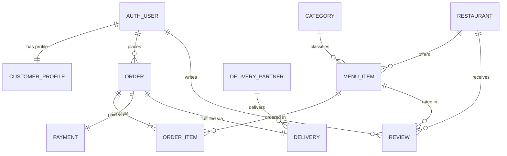

<div align="center">

# 🍔 OFO-DBMS
### Online Food Ordering System

A full-stack web application built with **Python · Django · SQLite** demonstrating real-world relational database design with a complete food delivery platform.

[](https://www.python.org/)
[](https://www.djangoproject.com/)
[](https://sqlite.org/)
[](https://getbootstrap.com/)
[](LICENSE)

</div>

---

## 📋 Table of Contents

- [About](#-about)
- [Features](#-features)
- [Database Schema](#️-database-schema)
- [Project Structure](#️-project-structure)
- [Getting Started](#-getting-started)
- [Environment Variables](#-environment-variables)
- [Running Tests](#-running-tests)
- [URL Endpoints](#-url-endpoints)
- [Contributing](#-contributing)
- [License](#-license)

---

## 🎯 About

**OFO-DBMS** is an academic DBMS project that simulates a production-grade food ordering platform — similar to Swiggy or Zomato — implemented from the ground up. It demonstrates core relational database concepts including entity relationships (1-to-1, 1-to-Many, Many-to-Many), atomic transactions, query optimization, and a dual-database architecture using Django's database router.

The project is fully functional with:
- A **customer-facing storefront** for browsing, ordering, and tracking food
- A **restaurant admin dashboard** for operations and analytics
- A **dual-database setup** (`food_ordering.db` for app data, `django_database.db` for framework internals)

---

## ✨ Features

### 👤 Customer Experience
| Feature | Description |
|---|---|
| 🔐 Secure Authentication | Register/Login with auto-created `CustomerProfile` (phone, address) |
| 🍽️ Dynamic Menu Discovery | Browse dishes organized into 5+ categories with icons |
| 🔍 Smart Search & Filters | Live search bar, category carousel, 🟢 Veg / 🔴 Non-Veg toggle, price & rating sort |
| 🛒 Persistent Cart | Multi-item session cart with quantity adjustments and real-time subtotals |
| 💳 Unified Checkout | Delivery address + 3 payment modes: **Cash on Delivery**, **UPI**, **Credit/Debit Card** |
| 📦 Order Tracking | 4-step visual stepper: *Placed → Preparing → Out for Delivery → Delivered* |
| 🧾 Printable Receipt | Itemized tax invoice for every order |

### 🛡️ Restaurant Admin Dashboard (`/orders/dashboard/`)
| Feature | Description |
|---|---|
| 📊 KPI Metrics | Total Revenue, Total Orders, Active Queue, Delivered, Menu Stock, Customers |
| 🔄 Live Order Queue | 1-click status changers: *Mark Preparing*, *Dispatch*, *Mark Delivered*, *Cancel* |
| 📋 Menu Stock Manager | Toggle dish availability (*In Stock / Sold Out*) in one click |
| 🚴 Driver Management | Onboard delivery partners and assign them to active deliveries |
| 📈 Analytics | Top-selling dishes, payment mode breakdown, category revenue stats |

---

## 🗄️ Database Schema

The application uses a **dual-database architecture**:
- `food_ordering.db` — All application models (Orders, Menus, Users, etc.)
- `django_database.db` — Django framework internals (sessions, admin logs, content types)



### Relationships Summary

| Relationship | Type | Description |
|---|---|---|
| `auth_user` ↔ `CustomerProfile` | 1-to-1 | Each user has one extended profile |
| `Category` ↔ `MenuItem` | 1-to-Many | Each dish belongs to one category |
| `Restaurant` ↔ `MenuItem` | 1-to-Many | Each dish is offered by one restaurant |
| `Order` ↔ `OrderItem` | 1-to-Many | An order contains one or more dish entries |
| `Order` ↔ `Payment` | 1-to-1 | Each order has exactly one payment record |
| `Order` ↔ `Delivery` | 1-to-1 | Each order has one delivery record |
| `DeliveryPartner` ↔ `Delivery` | 1-to-Many | A driver can handle multiple deliveries |

---

## 🏗️ Project Structure

```
OFO-DBMS/
│
├── accounts/               # Auth app: Registration, Login, CustomerProfile
│   ├── models.py           #   └─ CustomerProfile (1-to-1 with User)
│   ├── views.py            #   └─ signup, login, logout, profile views
│   ├── forms.py            #   └─ SignUpForm, ProfileUpdateForm
│   └── urls.py
│
├── restaurants/            # Menu app: Categories, Restaurants, MenuItems, Reviews
│   ├── models.py           #   └─ Category, Restaurant, MenuItem, Review
│   ├── views.py            #   └─ Storefront, search, filter logic
│   └── urls.py
│
├── orders/                 # Orders app: Cart, Checkout, Tracking, Dashboard
│   ├── models.py           #   └─ Order, OrderItem, Payment, DeliveryPartner, Delivery
│   ├── cart.py             #   └─ Session-based Cart engine
│   ├── views.py            #   └─ Cart, Checkout, Place Order, Tracking, Dashboard
│   ├── context_processors.py  # └─ Global cart counter injected into all templates
│   └── urls.py
│
├── dbms_project/           # Django project configuration
│   ├── settings.py         #   └─ Dual-DB setup, security config, environment vars
│   ├── db_routers.py       #   └─ Routes Django internals to django_database.db
│   └── urls.py             #   └─ Root URL configuration
│
├── templates/              # Bootstrap 5 HTML templates
│   ├── base.html           #   Master layout (navbar + cart counter)
│   ├── index.html          #   Storefront, search bar, food cards
│   ├── cart.html           #   Shopping cart manager
│   ├── checkout.html       #   Checkout & payment selector
│   ├── orders.html         #   Order history & status tracker
│   ├── dashboard.html      #   Admin console & analytics
│   ├── receipt.html        #   Printable order invoice
│   └── ...
│
├── .env.example            # Template for environment variables
├── .gitignore
├── manage.py
├── requirements.txt
├── run_tests.py            # Custom test runner
└── food_ordering.db        # SQLite database (not committed)
```

---

## 🚀 Getting Started

### Prerequisites
- Python **3.10+**
- `pip`
- Git

### 1. Clone the Repository

```bash
git clone https://github.com/YOUR_USERNAME/OFO-DBMS.git
cd OFO-DBMS
```

### 2. Create & Activate a Virtual Environment

```bash
# Windows
python -m venv .venv
.venv\Scripts\activate

# macOS / Linux
python -m venv .venv
source .venv/bin/activate
```

### 3. Install Dependencies

```bash
pip install -r requirements.txt
```

### 4. Set Up Environment Variables

```bash
# Copy the example file
cp .env.example .env

# Edit .env with your values (at minimum, set a SECRET_KEY)
```

### 5. Apply Database Migrations

```bash
python manage.py migrate
python manage.py migrate --database=django_database
```

### 6. Create a Superuser (Admin Account)

```bash
python manage.py createsuperuser
```

### 7. Run the Development Server

```bash
python manage.py runserver
```

The app will be live at **http://127.0.0.1:8000/** 🎉

---

## ⚙️ Environment Variables

Copy `.env.example` to `.env` and configure:

| Variable | Default | Description |
|---|---|---|
| `DJANGO_SECRET_KEY` | *(insecure dev key)* | **Required in production.** Use a long, random string. |
| `DJANGO_DEBUG` | `True` | Set to `False` in production. |
| `DJANGO_ALLOWED_HOSTS` | `127.0.0.1,localhost` | Comma-separated list of valid hostnames. |
| `DJANGO_SECURE_SSL_REDIRECT` | `True` | Force HTTPS (only when `DEBUG=False`). |
| `DJANGO_HSTS_SECONDS` | `31536000` | HSTS max-age in seconds (1 year). |

> ⚠️ **Never commit your `.env` file.** It is already listed in `.gitignore`.

---

## 🧪 Running Tests

The project includes unit tests for all three apps.

```bash
# Run all tests (using the custom runner)
python run_tests.py

# Or use Django's built-in test runner
python manage.py test accounts restaurants orders --verbosity=2
```

---

## 🔗 URL Endpoints

| URL | View | Description |
|---|---|---|
| `/` | `storefront` | Main menu browsing page |
| `/accounts/signup/` | `signup` | Customer registration |
| `/accounts/login/` | `login` | User login |
| `/accounts/profile/` | `profile` | View & edit customer profile |
| `/orders/cart/` | `cart` | Shopping cart manager |
| `/orders/checkout/` | `checkout` | Pre-order review & payment |
| `/orders/place/` | `place_order` | Finalize & submit order |
| `/orders/history/` | `order_history` | Customer order history & tracking |
| `/orders/receipt/<id>/` | `order_receipt` | Printable order invoice |
| `/orders/dashboard/` | `admin_dashboard` | Restaurant operations console *(staff only)* |
| `/admin/` | Django Admin | Full CRUD database administration |

---

## 🤝 Contributing

Contributions are welcome! Please read [CONTRIBUTING.md](CONTRIBUTING.md) to get started.

1. Fork the repository
2. Create a feature branch: `git checkout -b feature/your-feature-name`
3. Commit your changes: `git commit -m "feat: add your feature"`
4. Push to your fork: `git push origin feature/your-feature-name`
5. Open a Pull Request

---

## 📜 License

This project is licensed under the **MIT License** — see the [LICENSE](LICENSE) file for details.

---

<div align="center">
Made with ❤️ as an academic DBMS project
</div>
